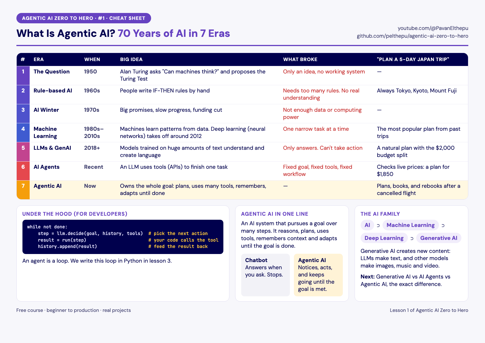

# Lesson 1: What Is Agentic AI? 70 Years of AI, Explained Simply

**Video:** (link coming) · **Files:** [cheat sheet](cheatsheet.pdf) · [slides](slides.pdf)

## In one minute

A chatbot answers when you ask, then stops. Agentic AI owns a goal: it plans, uses tools, remembers, and adapts until the goal is done. The flight-cancel example shows the difference. The chatbot doesn't notice the cancellation. Agentic AI notices it, rebooks, moves the hotel, updates the calendar and tells your team.

We got here in 7 eras: the Turing question (1950), rule-based AI (1960s), the AI winter (1970s), machine learning and deep learning (1980s-2010s), LLMs and generative AI (2018+), AI agents, and now Agentic AI. Each era solved one problem and revealed the next.

## Key terms

| Term | Meaning |
|---|---|
| Turing Test | If a judge can't tell a machine's replies from a human's, the machine passes |
| Machine learning | Machines learn patterns from data instead of hand-written rules |
| Deep learning | Machine learning with neural networks that have many layers |
| LLM | A model trained on huge amounts of text to understand and write language |
| Generative AI | AI that creates new content: text, images, music, video |
| AI agent | An LLM that uses tools to finish one task |
| Agentic AI | An AI system that pursues a goal over many steps and adapts until it's done |

## Further reading

- Alan Turing, [Computing Machinery and Intelligence](https://doi.org/10.1093/mind/LIX.236.433) (1950)
- Anthropic, [Building effective agents](https://www.anthropic.com/engineering/building-effective-agents) (2024)
- OpenAI, [Introducing ChatGPT agent](https://openai.com/index/introducing-chatgpt-agent/) (2025)

## Quick quiz

1. A chatbot plans your trip. Your flight is cancelled at 2 AM. What does the chatbot do?
2. Why did rule-based AI struggle?
3. What does Agentic AI have that an AI agent doesn't?

Answers

1. Nothing. It only answers when you ask.
2. Every new situation needed new rules, and the system didn't understand anything.
3. It owns the whole goal: it plans many tasks and adapts when something changes.

**Next:** [Lesson 2: Generative AI vs AI Agents vs Agentic AI](../02-genai-vs-ai-agents-vs-agentic-ai)
