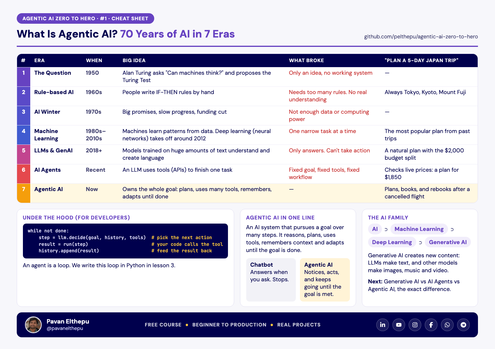

# Lesson 1: What Is Agentic AI? 70 Years of AI, Explained Simply

**Video:** [Watch on YouTube](https://youtu.be/WrUSY7RLuFs) (18:41) · **Course:** [full playlist](https://www.youtube.com/playlist?list=PLExTFh0CQIwU) · **Files:** [cheat sheet](cheatsheet.pdf)

## Chapters

| Time | Chapter |
|---|---|
| [0:00](https://www.youtube.com/watch?v=WrUSY7RLuFs&t=0s) | Chatbot vs Agentic AI: who saves your trip? |
| [1:02](https://www.youtube.com/watch?v=WrUSY7RLuFs&t=62s) | About this free course (TripPilot) |
| [3:25](https://www.youtube.com/watch?v=WrUSY7RLuFs&t=205s) | The evolution of AI: 70 years in 7 eras |
| [3:43](https://www.youtube.com/watch?v=WrUSY7RLuFs&t=223s) | 1950: Can machines think? The Turing Test |
| [4:35](https://www.youtube.com/watch?v=WrUSY7RLuFs&t=275s) | 1960s: Rule-based AI |
| [6:08](https://www.youtube.com/watch?v=WrUSY7RLuFs&t=368s) | 1970s: The AI winter |
| [6:37](https://www.youtube.com/watch?v=WrUSY7RLuFs&t=397s) | Machine learning and deep learning |
| [8:13](https://www.youtube.com/watch?v=WrUSY7RLuFs&t=493s) | LLMs and Generative AI |
| [9:42](https://www.youtube.com/watch?v=WrUSY7RLuFs&t=582s) | AI vs ML vs Deep Learning vs GenAI |
| [10:20](https://www.youtube.com/watch?v=WrUSY7RLuFs&t=620s) | Why LLMs can't take action |
| [10:46](https://www.youtube.com/watch?v=WrUSY7RLuFs&t=646s) | AI agents: AI that uses tools |
| [12:13](https://www.youtube.com/watch?v=WrUSY7RLuFs&t=733s) | Why AI agents aren't enough |
| [13:05](https://www.youtube.com/watch?v=WrUSY7RLuFs&t=785s) | Agentic AI: task vs goal |
| [15:38](https://www.youtube.com/watch?v=WrUSY7RLuFs&t=938s) | The AI analogy |
| [16:00](https://www.youtube.com/watch?v=WrUSY7RLuFs&t=960s) | Recap: 7 eras of AI |
| [17:05](https://www.youtube.com/watch?v=WrUSY7RLuFs&t=1025s) | The future of Agentic AI |
| [18:08](https://www.youtube.com/watch?v=WrUSY7RLuFs&t=1088s) | Up next: GenAI vs AI Agents vs Agentic AI |

## Cheat sheet

## In one minute

A chatbot answers when you ask, then stops. Agentic AI owns a goal: it plans, uses tools, remembers, and adapts until the goal is done. The flight-cancel example shows the difference. The chatbot doesn't notice the cancellation. Agentic AI notices it, rebooks, moves the hotel, updates the calendar and tells your team.

We got here in 7 eras: the Turing question (1950), rule-based AI (1960s), the AI winter (1970s), machine learning and deep learning (1980s-2010s), LLMs and generative AI (2018+), AI agents, and now Agentic AI. Each era solved one problem and revealed the next.

## Key terms

| Term | Meaning |
|---|---|
| Turing Test | If a judge can't tell a machine's replies from a human's, the machine passes |
| Machine learning | Machines learn patterns from data instead of hand-written rules |
| Deep learning | Machine learning with neural networks that have many layers |
| LLM | A model trained on huge amounts of text to understand and write language |
| Generative AI | AI that creates new content: text, images, music, video |
| AI agent | An LLM that uses tools to finish one task |
| Agentic AI | An AI system that pursues a goal over many steps and adapts until it's done |

## FAQ

**What is Agentic AI?**
An AI system that pursues a goal over many steps: it reasons, plans, uses tools, remembers and adapts until the goal is achieved. A chatbot only answers what you ask.

**What is the difference between an AI agent and Agentic AI?**
An AI agent uses tools to finish one task, like booking a flight. Agentic AI owns a whole goal, like managing a business trip. It plans many tasks and keeps going when something fails.

**Is ChatGPT Agentic AI?**
A normal ChatGPT chat is a chatbot: it answers your question and stops. Agent features that use tools to do tasks for you are a step toward Agentic AI.

**What is the difference between Generative AI and Agentic AI?**
Generative AI creates content when you ask. Agentic AI uses models like these to take actions toward a goal.

**How do AI, ML, deep learning and Generative AI connect?**
AI is the big family. Machine learning is AI that learns from data. Deep learning is machine learning with many-layer neural networks. Generative AI is deep learning that creates new text, images, music and video.

**Do I need coding for this course?**
Not for lessons 1 to 4. From lesson 5 we use basic Python, and every demo runs on a free model.

## The AI analogy

| AI | Is like | Does |
|---|---|---|
| Traditional AI (chatbots) | A calculator | Answers questions |
| Generative AI | A writer | Creates content |
| AI agents | Employees | Complete specific tasks |
| Agentic AI | An organization | Achieves goals |

## Further reading

- Alan Turing, [Computing Machinery and Intelligence](https://doi.org/10.1093/mind/LIX.236.433) (1950)
- Anthropic, [Building effective agents](https://www.anthropic.com/engineering/building-effective-agents) (2024)
- OpenAI, [Introducing ChatGPT agent](https://openai.com/index/introducing-chatgpt-agent/) (2025)

## Quick quiz

1. A chatbot plans your trip. Your flight is cancelled at 2 AM. What does the chatbot do?
2. Why did rule-based AI struggle?
3. What does Agentic AI have that an AI agent doesn't?

Answers

1. Nothing. It only answers when you ask.
2. Every new situation needed new rules, and the system didn't understand anything.
3. It owns the whole goal: it plans many tasks and adapts when something changes.

**Next:** [Lesson 2: Generative AI vs AI Agents vs Agentic AI](../02-genai-vs-ai-agents-vs-agentic-ai)
