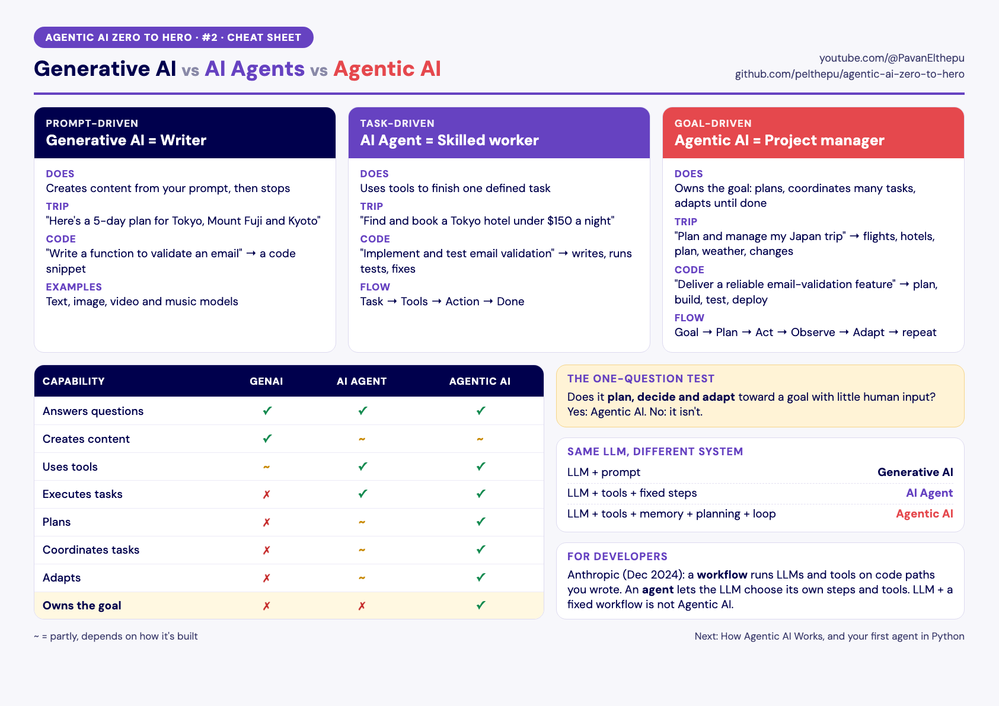

# Lesson 2: Generative AI vs AI Agents vs Agentic AI

**Video:** (link coming) · **Files:** [cheat sheet](cheatsheet.pdf) · [slides](slides.pdf)

## In one minute

| | Generative AI | AI Agent | Agentic AI |
|---|---|---|---|
| Driven by | A prompt | A task | A goal |
| Think of it as | A writer | A skilled worker | A project manager |
| Trip example | Writes a 5-day plan | Finds and books one hotel | Plans and manages the whole trip |
| Stops when | It has written the answer | The task is done | The goal is met |

**The one-question test:** does it plan, decide and adapt toward a goal with little human input? If not, it isn't Agentic AI.

**Same LLM, different system:** LLM + prompt = generative AI. LLM + tools + fixed steps = AI agent. LLM + tools + memory + planning + a loop = Agentic AI.

## For developers

Anthropic splits agentic systems into **workflows** (LLMs and tools run on code paths you wrote) and **agents** (the LLM chooses its own steps and tools). An LLM plugged into a fixed workflow is not Agentic AI. In lesson 3 we write the loop that turns an LLM into an agent.

## Further reading

- Anthropic, [Building effective agents](https://www.anthropic.com/engineering/building-effective-agents) (2024)
- OpenAI, [Introducing ChatGPT agent](https://openai.com/index/introducing-chatgpt-agent/) (2025)

## Quick quiz

1. "Write a function to validate an email." Which of the three is this?
2. An LLM runs the same 4 steps every time, in a fixed order. Is it Agentic AI?
3. Which capability does only Agentic AI have?

Answers

1. Generative AI: it creates content from a prompt.
2. No. It follows a fixed workflow and doesn't plan or adapt.
3. It owns the goal.

**Next:** [Lesson 3: How Agentic AI Works](../03-how-agentic-ai-works) · **Previous:** [Lesson 1](../01-what-is-agentic-ai)
