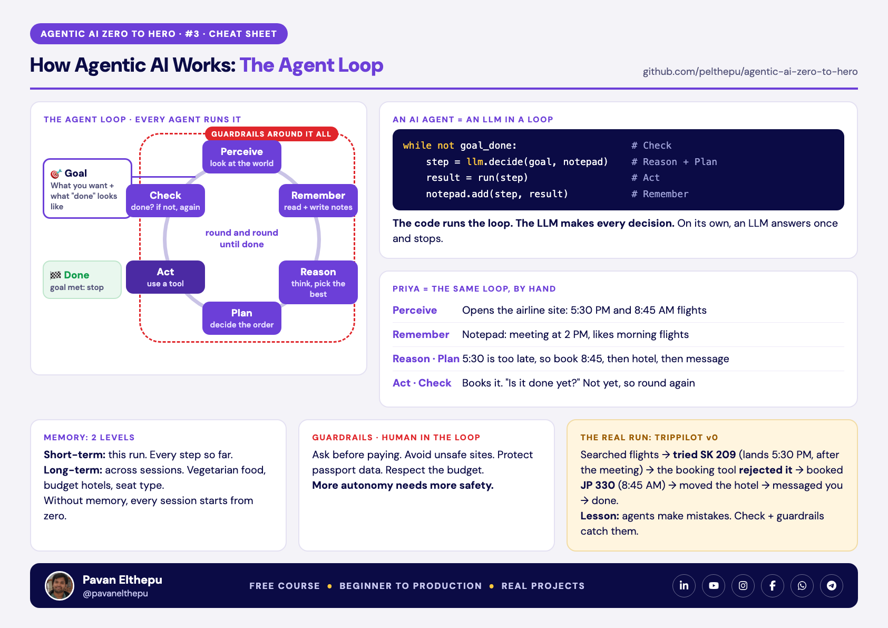

# Lesson 3: How Agentic AI Works: The Agent Loop, Explained Simply

**Video:** [Watch on YouTube](https://youtu.be/_IFipLedyiA) (17:43) · **Course:** [full playlist](https://www.youtube.com/playlist?list=PLExTFh0CQIwU) · **Files:** [cheat sheet](cheatsheet.pdf) · **Code:** none today. We build this agent in [lesson 8](../08-build-your-first-ai-agent)

[](https://www.youtube.com/watch?v=_IFipLedyiA)

## Chapters

| Time | Chapter |
|---|---|
| [0:00](https://www.youtube.com/watch?v=_IFipLedyiA&t=0s) | How does Agentic AI work? |
| [1:07](https://www.youtube.com/watch?v=_IFipLedyiA&t=67s) | Everyday example: Priya fixes a cancelled flight |
| [2:29](https://www.youtube.com/watch?v=_IFipLedyiA&t=149s) | Priya's rounds as a loop |
| [4:34](https://www.youtube.com/watch?v=_IFipLedyiA&t=274s) | Who runs the loop? An LLM in a loop |
| [5:54](https://www.youtube.com/watch?v=_IFipLedyiA&t=354s) | Each step in detail: the Japan trip |
| [6:18](https://www.youtube.com/watch?v=_IFipLedyiA&t=378s) | Step 1: Goal |
| [6:44](https://www.youtube.com/watch?v=_IFipLedyiA&t=404s) | Step 2: Perceive |
| [7:21](https://www.youtube.com/watch?v=_IFipLedyiA&t=441s) | Step 3: Remember (short- and long-term memory) |
| [8:17](https://www.youtube.com/watch?v=_IFipLedyiA&t=497s) | Step 4: Reason |
| [9:21](https://www.youtube.com/watch?v=_IFipLedyiA&t=561s) | Step 5: Plan |
| [10:00](https://www.youtube.com/watch?v=_IFipLedyiA&t=600s) | Step 6: Act with tools |
| [11:00](https://www.youtube.com/watch?v=_IFipLedyiA&t=660s) | Step 7: Check and adapt |
| [11:49](https://www.youtube.com/watch?v=_IFipLedyiA&t=709s) | Step 8: Guardrails and human in the loop |
| [12:35](https://www.youtube.com/watch?v=_IFipLedyiA&t=755s) | The complete agent loop + the 6 signs |
| [13:18](https://www.youtube.com/watch?v=_IFipLedyiA&t=798s) | Watch TripPilot fix a cancelled flight (real run) |
| [15:13](https://www.youtube.com/watch?v=_IFipLedyiA&t=913s) | What this run teaches |
| [16:27](https://www.youtube.com/watch?v=_IFipLedyiA&t=987s) | Recap |
| [16:51](https://www.youtube.com/watch?v=_IFipLedyiA&t=1011s) | Homework |
| [17:04](https://www.youtube.com/watch?v=_IFipLedyiA&t=1024s) | Up next: Inside an Agentic AI System |

## Cheat sheet



## In one minute

Every AI agent runs one loop: **Goal → Perceive → Remember → Reason → Plan → Act → Check**, and round again until the goal is done, with guardrails around it all.

An AI agent is an **LLM in a loop**. The code runs the loop. The LLM makes every decision. On its own, an LLM answers once and stops. In the loop, it keeps going until the goal is done.

## Priya, the everyday example

Your flight to Tokyo is cancelled. You call Priya, your travel assistant: "Get me to Tokyo before my 2 PM meeting." She doesn't fix it all in one go. She works in rounds.

| Step | What Priya does |
|---|---|
| Goal | Your call: in Tokyo before 2 PM |
| Perceive | Opens the airline website: one flight lands at 5:30 PM, one at 8:45 AM |
| Remember | Reads her notepad (meeting at 2 PM, you like morning flights) and writes down the 2 flights |
| Reason | 5:30 PM is after the meeting, so 8:45 AM is the right one |
| Plan | Book the flight, then move the hotel, then message you |
| Act | Books the flight on the website |
| Check | "Is it done yet?" Not yet, so she goes round again |
| Guardrails | Calls you before she pays |

Put an AI agent in Priya's place, and nothing else changes. That's the agent loop.

## The loop in code (just the idea)

```python
while not goal_done:                      # Check
    step = llm.decide(goal, notepad)      # Reason + Plan
    result = run(step)                    # Act
    notepad.add(step, result)             # Remember
```

You don't need to run this. We write the real version in [lesson 8](../08-build-your-first-ai-agent).

## The 8 steps, on the Japan trip

Goal: *"Plan a 5-day trip to Japan with a budget of $2,000. I have a meeting in Tokyo on 12 Nov at 2 PM."*

| Step | What the agent does |
|---|---|
| 1. Goal | Pulls out the mission: Japan, 5 days, $2,000, in Tokyo before 12 Nov, 2 PM |
| 2. Perceive | Checks airline sites, hotel APIs, weather, visa rules, maps |
| 3. Remember | Short-term: every step this run. Long-term: you like budget hotels and vegetarian food |
| 4. Reason | Is Tokyo too expensive? Is a rail pass worth it? |
| 5. Plan | What goes first: flight dates before hotels. Visa and hotel search can run together |
| 6. Act | Uses tools: flight API, maps API, hotel platform, calendar, payment |
| 7. Check | The Kyoto hotel is sold out. Round again: book another hotel near the station |
| 8. Guardrails | Hotel is $150 over budget, so ask a human first (human in the loop) |

## The 6 signs from lesson 2, on the loop

| Sign | Where it lives |
|---|---|
| Goal-driven | Goal |
| Memory | Remember |
| Planning | Plan |
| Tool usage | Act |
| Feedback-driven | Check |
| Autonomy | The whole loop, running on its own |

## The real run: TripPilot v0

Goal: *"My flight from Delhi to Tokyo got cancelled. I have a meeting in Tokyo on 12 Nov at 2 PM. Fix my trip."*

| # | TripPilot does | Loop step |
|---|---|---|
| 1 | Searches flights: SK 209 lands 5:30 PM, JP 330 lands 8:45 AM | Perceive |
| 2 | Tries to book SK 209. The booking tool rejects it: it lands after the meeting | Act + guardrail |
| 3 | Reads the error: "SK 209 is too late. Find another flight." | Check + Reason |
| 4 | Books JP 330 | Act |
| 5-6 | Moves the hotel check-in, sends you a message | Act |
| 7 | Everything is done, so it stops | Check |
| Notepad | Writes down every step, so it knows SK 209 already failed | Remember |

**What to notice:** real agents make mistakes. That's why the Check step and guardrails matter. And the notepad only lasts one run. TripPilot v0 has no long-term memory yet. We add that in the memory lessons.

## FAQ

**How does Agentic AI work?**
It runs a loop: understand the goal, look at the world, check its memory, think, plan, act with tools, and check the result. If the goal isn't done, it goes round again.

**What does "an AI agent is an LLM in a loop" mean?**
On its own, an LLM answers once and stops. In a loop, it decides the next step in every round. The code runs that step, writes down the result, and asks again.

**What is the difference between short-term and long-term memory?**
Short-term memory is the notepad for one run. Long-term memory lasts across sessions, like your favourite airline or seat.

**What are guardrails?**
Safety rules around the loop: ask a human before paying, avoid unsafe sites, protect private data, respect the budget. Asking a human first is called human in the loop (HITL).

## Homework

Pick one goal from your own life, like "Plan my friend's birthday party." Write down what the agent would do in each of the 8 steps. Post it in the video's comments.

## Quick quiz

1. Which step comes right after Act?
2. In an AI agent, who runs the loop, and who makes the decisions?
3. TripPilot tried a flight that landed too late. What stopped it?
4. How long does TripPilot v0's notepad last?

<details><summary>Answers</summary>

1. Check.
2. The code runs the loop. The LLM makes every decision.
3. A guardrail: a rule inside the booking tool rejected it.
4. One run. When the run ends, it's wiped.

</details>

## Further reading

- Anthropic, [Building effective agents](https://www.anthropic.com/engineering/building-effective-agents) (2024)

**Next:** Lesson 4: Inside an Agentic AI System · **Previous:** [Lesson 2](../02-genai-vs-ai-agents-vs-agentic-ai)
